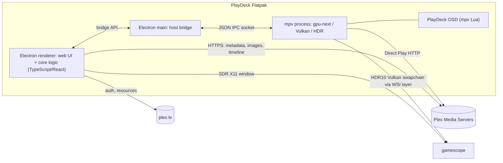

# PlayDeck Design

Status: agreed design, 2026-10-20. This document is the single source of truth for scope and architecture. Changes to any decision below should be made here first.

PlayDeck is an open-source (GPL-3.0-or-later) Plex client for SteamOS Gaming Mode (gamescope). It is designed for gamepad and remote control, and plays HDR10 and Dolby Vision content as real HDR output instead of tone-mapping it to SDR.

## 1. Goals and non-goals

### Goals (v1)

- Play movies and TV shows from one or more Plex Media Servers.
- Correct HDR output for HEVC/AVC content, including HDR10 and Dolby Vision Profile 5, 8.1 and 8.4.
- Full gamepad and remote-control operation with a 10-foot UI.
- Acceptance device: Steam Deck OLED, on the internal panel. External displays (1080p and 4K, SDR and HDR) are in scope but deferred to a later milestone (section 13), together with their tests.
- Runs on stock SteamOS (stable channel) with no root filesystem or session changes.
- All common configuration is available in the UI.
- Browsing UI sustains 90 fps on the internal panel and 60 fps at native resolution on external displays.

### Non-goals (v1)

- Transcoding. Playback is Direct Play only.
- Music, photos, Live TV and downloads.
- Audio passthrough (bitstreaming). Audio is decoded to PCM.
- Dolby Vision display management, and Profile 7 FEL. Profile 7 plays its base layer only.
- HDR10+ dynamic metadata. HDR10+ content plays as HDR10.
- Seek-bar thumbnail previews.
- Online subtitle search.
- 120 Hz external displays.
- Multiple simultaneous plex.tv accounts.
- Telemetry or crash reporting of any kind.

## 2. Platform constraints

These were verified against source code or primary reports, and they drive the architecture.

1. **The only HDR path in Gaming Mode is an X11 Vulkan swapchain through the gamescope WSI layer.** The application creates a Vulkan swapchain with `VK_COLOR_SPACE_HDR10_ST2084_EXT` on an Xwayland window. The `VkLayer_FROG_gamescope_wsi` layer then forwards it to gamescope over the private `gamescope_swapchain` protocol.
   - Native Wayland surfaces get no HDR formats: the layer hard-codes `hdrOutput = false` for them (`layer/VkLayer_FROG_gamescope_wsi.cpp`, gamescope `74a06ff`, 2026-10-17).
   - gamescope's Wayland server does not expose `wp_color_management_v1` or `frog_color_management_v1` to clients. These protocols are only used by gamescope's nested Wayland backend.
   - Consequence: Wayland-based HDR players, such as Kodi 22, Plezy and Jellyfin Desktop, cannot output HDR in Gaming Mode, even with `--expose-wayland`. See [SteamOS#2166](https://github.com/ValveSoftware/SteamOS/issues/2166).
2. **The HDR window must be an unobscured, full-size toplevel.** The WSI layer only exposes HDR formats when no child window larger than 1x1 covers the Vulkan window, and when the window matches its toplevel's size (see `canBypassXWayland()`). A UI drawn as a child window over the video therefore forces SDR.
3. **libmpv cannot render HDR when embedded.** The upstream render API has no Vulkan or `gpu-next` backend ([mpv#16818](https://github.com/mpv-player/mpv/pull/16818) is still a draft; see also [mpv#6575](https://github.com/mpv-player/mpv/issues/6575)). Standalone mpv with `vo=gpu-next`, `gpu-api=vulkan` and `target-colorspace-hint` is known to produce HDR in Gaming Mode on the Deck OLED.
4. **Dolby Vision.** libplacebo applies the Profile 5 and 8.x base-layer and RPU reshaping, and outputs PQ/BT.2020. Without the RPU, Profile 5 renders with a green/purple cast. FEL is not supported.
5. **Existing clients do not fit.**
   - Plex HTPC disables HDR on Linux and is closed source ([forum](https://forums.plex.tv/t/is-hdr-blocked-for-linux/921328)).
   - Plezy's Linux video plane needs native Wayland: X11 sessions refuse video, and it uses the legacy `gpu` renderer, which has no Dolby Vision support.
   - Kodi on Linux does not apply DV RPUs.
   - Plex Companion casting, which plex-mpv-shim depends on, is broken in the 2026 Plex apps ([forum](https://forums.plex.tv/t/remote-control-companion-casting-completely-broken-on-android-tv-since-new-plex-experience-serve/943129)).
6. **Steam's "Game Resolution" setting defaults to Default.** When docked, this renders the app at roughly 1280x720 or 1280x800 and gamescope upscales it. Sharp 4K output requires two settings: Steam's external output resolution set to native, and the shortcut's Game Resolution (or the global Maximum Game Resolution) set to Native.

## 3. Architecture

### 3.1 Process model (Path A)

- There are two full-screen toplevel windows, and only one is visible at a time. The Electron window shows browsing and settings in SDR. During playback, the Electron window is hidden and the mpv window is shown, in HDR when the content is HDR.
- **Core logic lives in the web layer**: the Plex API, application state and the playback controller. This keeps it independent of the host, so that Path B (section 13) can replace Electron with a native host without rewriting it.
- **The host bridge is deliberately thin.** It handles the mpv process and IPC, configuration files, display information, gamescope X properties and window visibility.
- During playback, mpv handles all input itself; the host only forwards the gamepad to it (section 7.1). The UI generates mpv's `input.conf` from the user's key-mapping settings.

### 3.2 Host bridge surface (draft)

| Area | Operations |
|---|---|
| Player (version 2) | `start(session, options)`, `next(session)`, `stop()`; events: `playing`, `progress`, `tracks`, `next`, `ended`. Around playback the host itself hides and shows the UI window and sets the refresh rate through `gamescope_control.set_app_target_refresh_cycle` on gamescope's Wayland socket (section 3.3). |
| Display (M5) | native mode from the EDID (`GAMESCOPE_DISPLAY_EDID_PATH`), HDR output state (`GAMESCOPE_HDR_OUTPUT_FEEDBACK`); connector, internal/external, HDR/VRR flags and valid refresh rates from `gamescope_control.active_display_info`; window size and scale factor |
| Config | read and write the settings file; path of the user `mpv.conf` override |
| System | open URLs and QR codes, app paths, log access |

The bridge interface is versioned and documented so that it can be re-implemented by a future native host.

### 3.3 Playback handoff

1. The UI builds a play session:
   - the Direct Play URL (`{connection}{part.key}`) and the Plex headers that go with it, token included;
   - the resume offset;
   - the audio and subtitle streams, with the selected ones and the sidecar subtitle URLs;
   - the markers, the frame rate and the next episode;
   - the OSD's text in the UI language.
2. The host writes the session to a file that only the user can read, then spawns mpv idle and paused:
   - full screen, with `--input-ipc-server`, the PlayDeck OSD script, and the generated `input.conf`;
   - then the user's `mpv.conf` override, which is included last.

   The OSD script reads and deletes the file, sets the headers and loads the URL paused, so the token is never on a command line or in a log.
3. Once the file has loaded and its first frame is up, the host waits for `vo-configured` and hides the Electron window. gamescope then focuses the mpv window (verified in S1).
4. The host applies the refresh-rate policy (section 5.3) while mpv is still paused, waits for the mode switch to settle, and then unpauses.
5. The host passes mpv's position to the UI, which reports it to Plex (section 6.4). The OSD script handles input itself. It tells the host, through script messages, when a track is chosen and when the next episode should play.
6. When mpv exits, the host restores the refresh rate and shows the Electron window again.

Refresh changes are kept outside active playback because each mode switch costs about 0.6 s and drops frames (S4).

## 4. HDR and color policy

| Display | Content | Behavior |
|---|---|---|
| HDR (internal OLED or external) | HDR10 | Output PQ/BT.2020 and pass through the static metadata (mastering display, MaxCLL/MaxFALL). No client-side tone mapping. On the internal panel, gamescope maps the signal to the panel. |
| HDR | Dolby Vision P5 / P8.1 / P8.4 | Apply the RPU reshaping (this is a decoding step). No DV dynamic display mapping. Output PQ with static HDR10 metadata derived from the RPU. P8.4 (HLG base) is also output as PQ. |
| HDR | HDR10+ | Played as HDR10. Dynamic metadata cannot be passed through gamescope. |
| HDR | DV P7 | Base layer only (HDR10). |
| HDR | SDR | Output as SDR. gamescope composites it at the user's SDR brightness. |
| SDR (or HDR disabled in Steam) | Any HDR | Tone mapping cannot be avoided here. libplacebo tone-maps it, with DV handled correctly. |

- Subtitles and the OSD render at 203 nits (reference white) during HDR playback. This is adjustable in settings.
- The baseline mpv configuration is `vo=gpu-next`, `gpu-api=vulkan`, `target-colorspace-hint=yes`, `hwdec=vaapi`. If spike S2 shows that native VA-API interop breaks DV, fall back to `vaapi-copy`.

## 5. Display, layout and refresh rate

The TV layout and the resolution guard (sections 5.1 and 5.2) belong to milestone M5. Until then only the handheld layout is built, but nothing may hard-code the internal panel's size or scale.

### 5.1 Layouts

There are two layout variants sharing one component set. Both use the same logical font sizes: a logical pixel subtends a similar visual angle on a handheld at about 40 cm and on a 55" TV at about 2.5 m.

| Target | Layout | Logical size | Scale |
|---|---|---|---|
| Deck internal 1280x800 | Handheld (16:10) | 1280x800 | 1x |
| 1080p display | TV (16:9) | 1920x1080 | 1x |
| 1440p display | TV (16:9) | 1920x1080 | 1.33x |
| 4K display | TV (16:9) | 1920x1080 | 2x |

- **Other aspect ratios:** pick the closest layout, scale it by height, and use the extra width for additional columns.
- **Native rendering only:** there is no bitmap upscaling of the UI. The "UI size" setting (90–150%) changes the logical layout size; the output is still rendered at native resolution.
- **Images:** posters and backdrops are requested at their physical pixel size, which is 2x at 4K.

### 5.2 Resolution guard

At startup and on display changes, PlayDeck compares its window size with the native mode from the display's EDID. If they differ, it shows a guide explaining how to set Steam's external output resolution and the shortcut's Game Resolution to Native, with a "don't show again" option. v1 never edits Steam's configuration files.

### 5.3 Refresh rate

- **Internal panel:** during playback, the panel runs at an integer multiple of the content frame rate.
  - The switch is requested with `gamescope_control.set_app_target_refresh_cycle(fps, internal_display | allow_refresh_switching | only_change_refresh_rate)`, and reset with `fps = 0`. gamescope picks the highest valid rate that is a multiple of `fps`.
  - The Deck OLED panel's valid rates are 45–90 Hz with gaps, which gives 23.976/24p → 72 Hz, 25p → 50 Hz, 29.97/30p → 90 Hz, 50p → 50 Hz and 59.94/60p → 60 Hz. The host computes the same answer from `active_display_info` so that it can tell mpv.
  - mpv must be told the new rate with `display-fps-override`, because Xwayland's RandR mode keeps reporting the native rate after a dynamic switch.
  - Writing the `GAMESCOPE_DYNAMIC_REFRESH` root property has no effect: gamescope recomputes it every frame from the app target refresh cycle.
  - gamescope changes the mode only on a frame drawn a while after the target changed, and an idle page draws no frames. When playback ends, the UI runs a faint 1.5 s opacity animation, and the panel is back at 90 Hz about 1 s after mpv exits. Without it, the panel stayed at 72 Hz until the next focus move.
  - Automatic switching can be turned off in settings.
- **External displays:** no mode switch. mpv uses `video-sync=display-resample`.

## 6. Plex integration

### 6.1 Authentication and users

- Sign in with the plex.tv PIN flow: the screen shows a link code and a QR code, and the user approves on a phone. No password is entered on the device.
- One plex.tv account at a time. Plex Home user switching, including PIN entry, is supported in v1.

### 6.2 Servers and connections

- Discover every server the account can reach, both owned and shared, from plex.tv resources. Servers can also be added manually by URL.
- Each server uses its best working connection: local first, then remote direct. Relay connections are marked unusable because their bandwidth cannot sustain Direct Play.

### 6.3 Content

- **Home:** "Continue Watching" and "Recently Added", merged across servers.
- **Libraries:** browsed per server and per library.
- **Search:** covers all servers.
- **Detail pages:** movies, and shows with their seasons and episodes.
- **Actions:** mark watched or unwatched, choose a version.
- **Media information:** below the details, each version's file and its video, audio and subtitle tracks.
- **Subtitles:** embedded tracks and server-side sidecar files.
- **Images:** requested through the Plex photo transcoder at display size.

### 6.4 Playback state

- **Direct Play only.** If a stream cannot be played directly (for example, not enough bandwidth), PlayDeck reports this and does not fall back to transcoding.
- **Resume and progress:** resume from the saved offset; report timeline progress and scrobble on completion.
- **Track selection:** Plex audio and subtitle streams are mapped to mpv tracks, and the selection is persisted to the server.
- **Markers:** intro and credits markers drive the skip button. Auto-skip is a setting, off by default.
- **Next episode:** autoplay is on by default.

Plezy (GPL-3.0) may be used as a reference for Plex API behavior, such as connection selection, markers and timeline reporting.

## 7. Input

### 7.1 Sources

- **Primary:** the Steam Input virtual gamepad. Chromium reads it through the Gamepad API. During playback, the host reads the same device from evdev and sends the presses to mpv as key events over IPC, because Flathub mpv is built without SDL gamepad support.
- **Keyboard-style remotes:** Flirc, Bluetooth remotes and keyboards (arrows, Enter, Esc/Backspace, media keys).
- **Touch and mouse:** must work, but are not optimized.
- **Reserved:** the Steam and QAM buttons belong to the system.
- A recommended Steam Input layout ships with the app.

### 7.2 Browse mapping (defaults, all remappable)

| Input | Action |
|---|---|
| D-pad / left stick | Move focus |
| Right stick / wheel | Scroll the focused card's content (the subtitle list) a page at a time |
| A / Enter | Select |
| B / Esc / Backspace | Back. Twice on Home, ask "Quit PlayDeck?" |
| X | Context menu (watched state, version); Delete on the search keyboard |
| Y | Sort on a library page |
| LB / RB | Switch top tabs (Home, Libraries, Search) |
| LT / RT | Page up and down in grids, or jump by letter |
| Menu (☰) | Settings |

- A bar along the bottom of the screen shows, SteamOS style, the buttons that do something for the focused element and its screen. LB and RB glyphs flank the top tabs.
- The top tabs never take focus; LB/RB (or a tap) switch them, and focus stays in the tab's content.
- Dialogs and Settings have no Close button: B closes them, and the bar says so.
- The double B on Home is left out of the bar. Quitting is not in Settings.

### 7.3 Playback OSD (mpv Lua, defaults, all remappable)

| Input | Action |
|---|---|
| A | Pause or resume, and show the OSD. In a menu, select. When the next-episode card or a skip prompt is visible, activate it. |
| D-pad left / right | Seek −10 s / +10 s. Holding repeats, in 30 s steps after 6 repeats and 60 s steps after 16. The bar moves at once, and the seek happens when it has rested for 0.3 s. |
| D-pad up / down | Show the OSD; move in menus |
| LB / RB | Previous / next chapter, or "No chapters" |
| Y | Audio and subtitle track menu |
| X | Stats overlay (mpv's stats page: HDR/DV state, codec, bitrate, dropped frames) |
| Menu (☰) | Playback menu: speed, audio delay, subtitle delay, subtitle size. A resets the row. |
| B | The first that applies: close the menu, cancel the next-episode card, hide the OSD, dismiss the skip prompt. Otherwise ask "Stop playback?" |

- **OSD:** the title, a progress bar with buffered ranges, chapter ticks and markers, the time, the time left and when it ends, and a clock. It auto-hides after 4 s. The button hints run along the bottom, like the UI's hints bar.
- **Skip intro / credits:** a prompt is shown while playback is inside a Plex marker.
- **Next episode:** at the last credits marker, or 10 s before the end without one, a "Next episode in 10 s" card appears. A plays it now; B cancels. With autoplay off, the card has no countdown and waits.
- Keyboards and remotes get the same actions: arrows, Enter/Space, Esc/Backspace, Page Up/Down, Tab (tracks), `i` (stats), `m` (menu), `q` (stop), and the media keys.
- The OSD is written for gamepads from scratch; uosc is mouse-oriented.

## 8. UI

- **Stack:** Electron, TypeScript and React, with a spatial-navigation library suitable for TV UIs.
- **Visual direction:** a dark Apple TV / Infuse style. A large backdrop hero sits above horizontal poster rows, and the focused card scales up. The focus ring follows Steam's Big Picture style.
- **Languages:** i18n from day one, shipping English and Simplified Chinese.

### 8.1 Performance budgets

| Display | Target | p95 frame interval | Dropped frames |
|---|---|---|---|
| Internal panel (90 Hz) | 90 fps | ≤ 11.1 ms | ≤ 1% of intervals > 16.7 ms |
| External 1080p60 / 4K60 (native resolution) | 60 fps | ≤ 16.7 ms | ≤ 1% of intervals > 25 ms |

- **Scenarios covered:** focus movement, horizontal row scrolling, vertical grid scrolling in a 5,000-item library, page transitions, and images streaming in while scrolling.
- **First load:** a page may show skeleton placeholders on first load, but must not stutter.
- **Idle:** when nothing changes, no frames are produced.
- **Priority:** frame rate wins over visual effects; any effect that breaks the budget is removed.
- **Measurement:** a scripted navigation harness drives the UI for 60 s and records `requestAnimationFrame` intervals, cross-checked against Steam's performance overlay. The harness is kept and run on the Deck before every release.

### 8.2 Engineering rules

- Animate only `transform` and `opacity`. Never animate layout properties.
- The focus ring is a single element moved with `transform`. Focus changes must not re-render cards.
- Lists and grids are virtualized and use fixed-size cells.
- Images are requested at display size, decoded asynchronously before insertion, and kept in a memory cache and a disk cache.
- Do not use `backdrop-filter` on scrolling content. Use pre-blurred images instead.
- Do not repaint large layers when focus changes. Plex's UltraBlur colours are drawn into a 2x2 canvas that the GPU stretches over the screen; changing a full-screen CSS gradient would re-rasterize the whole layer.
- An image that fades in is first drawn at near-zero opacity for two frames. `img.decode()` fills Blink's cache, but the GPU rasterizer decodes and uploads again on first draw; the warm-up keeps that cost out of the animation.
- Reserve space for late-loading images (fixed boxes), so they never shift the layout under the focus ring.
- Focus state is the `data-focused` attribute, not a class: React rewrites `className` on re-render and would drop it.
- Confirm in `chrome://gpu` that rasterization and compositing are hardware accelerated, and that frames are produced at the panel refresh rate.

## 9. Settings

- Settings editable in the UI:
  - accounts and servers;
  - which libraries feed Home, and each library's sort order;
  - default audio and subtitle languages;
  - subtitle style and size;
  - HDR subtitle and OSD brightness;
  - automatic refresh switching;
  - hardware decoding;
  - UI size and UI language;
  - key mappings;
  - marker auto-skip and next-episode autoplay.
- Settings are stored in one human-readable file. Editing the file and editing in the UI are equivalent.
- Advanced users can supply an `mpv.conf` override. It is the only option that requires editing a file, and the UI shows its path.

## 10. Audio

- v1 decodes audio to PCM. External sinks get multichannel LPCM up to what the sink supports. The internal speakers and headphones get a stereo downmix.
- TrueHD keeps its 7.1 bed; Atmos object metadata is lost.
- Passthrough is future work.

## 11. Packaging, distribution and licensing

- **Format:** a Flatpak based on the Electron base app.
  - It bundles mpv, FFmpeg, libplacebo, libass and SDL, built at pinned versions, so that HDR and DV behavior is deterministic.
  - It requires the `org.freedesktop.Platform.VulkanLayer.gamescope` extension and `--filesystem=xdg-run/gamescope-0:ro`.
- **Distribution:**
  - First as `.flatpak` files on GitHub Releases, then on Flathub.
  - An "Add to Steam" helper creates the non-Steam shortcut with artwork and the recommended controller layout. It does not touch Steam's resolution settings (see section 5.2).
- **Identity:** the working name is PlayDeck, with app ID `io.github.<user>.PlayDeck`. Check for name collisions before submitting to Flathub.
- **License:** GPL-3.0-or-later.
- **Repository:** hosted on the maintainer's GitHub account, made public once spikes S1–S5 pass.

## 12. Development workflow

- **Deck access:**
  - The Deck runs `sshd`, with a `steamdeck` host entry and key-based login.
  - Builds are deployed with `rsync` to a fixed directory.
  - A fixed non-Steam shortcut, "PlayDeck (dev)", runs that directory's launcher script. It is started remotely with `steam steam://rungameid/<id>` so that it runs inside Gaming Mode.
- **Diagnostics:** logs from mpv, the WSI layer and the application are collected over SSH. Visual HDR quality is verified by eye on the device and the display.
- **Builds:** local builds use an x86_64 Linux environment. Release Flatpaks are built by GitHub Actions.

## 13. Milestones

| Milestone | Scope |
|---|---|
| M0 Spikes | S1–S5 (section 14). If S1, S2 or S3 fails, re-evaluate the architecture. If S5 fails after tuning, switch the UI to Qt/QML. |
| M1 Skeleton | Electron app, host bridge, settings storage, i18n, focus navigation framework; PIN sign-in, multi-server discovery and connection selection, Plex Home switching |
| M2 Browse | Merged home, library grids, detail pages, cross-server search; performance harness passing |
| M3 Playback | mpv handoff, resume, timeline and scrobble, track mapping, subtitles, HDR policy, refresh switching, Lua OSD, markers, next episode |
| M4 Packaging | Flatpak with bundled media stack, GitHub Actions, Add-to-Steam helper, Steam Input layout, documentation |
| M5 External displays | TV layout, resolution guard, external refresh behavior; S3 external and S5 external tests |

### 13.1 M1 implementation notes

- **Layout.** The application lives in `app/`:
  - `electron/` is the host: main process, preload and storage.
  - `shared/bridge.ts` is the bridge contract (version 1).
  - `src/core/` is UI-independent: Plex API, sign-in, session, server registry and i18n.
  - `src/ui/` holds the input mapping, the focus engine and the screens.
  - `test/` holds unit tests (`npm test`). `test/live/` holds tests against the real account in `.env` (`npm run test:live`); they are never part of `npm test`.
- **Storage** is in `~/.config/PlayDeck/`:
  - `settings.json`: user-editable;
  - `credentials.json`: mode 0600, holding the account and current-user tokens (and, since 13.3, the last Home users and server list);
  - `identity.json`: the X-Plex-Client-Identifier.

  There is no OS keyring in Gaming Mode, so tokens rely on file permissions.
- **Sign-in** creates two PINs at once:
  - a strong PIN, encoded in the QR code as the `app.plex.tv/auth` URL (30 min);
  - a 4-character PIN for plex.tv/link (15 min).

  Both are polled; expired PINs are replaced.
- **Account API.** Calls go to `clients.plex.tv/api/v2`, falling back to `plex.tv/api/v2` on network errors. Both send `Access-Control-Allow-Origin: *`, and Plex Media Server echoes the `playdeck://app` origin, so all Plex traffic runs in the web layer.
- **Session restore.**
  - A rejected token signs out.
  - An unreachable plex.tv keeps the stored session.
  - A Plex Home with more than one user asks who is watching, unless a remembered user is still in the home.
  - Protected users, including a protected admin, require their PIN through `/home/users/{uuid}/switch`.
- **Connection selection.**
  - Probes hit the authenticated root `/`, which proves reachability, token validity and `machineIdentifier` in one request.
  - Relays are excluded, and a cleartext fallback is synthesized only for LAN connections.
  - A success is accepted once every better tier has failed. Local probes time out after 1.5 s and remote probes after 6 s.
  - Manually added addresses come first and are matched to servers through the unauthenticated `/identity`.
  - Live result against the maintainer's server from outside its LAN: a remote HTTPS connection at about 100 ms, settled in 2.4 s. The manual address settles in 0.4 s.
- **Focus engine.** Small screens use spatial navigation over `[data-focusable]` elements. Large collections register a region that handles its own movement (the S5 approach). There is a single focus ring moved by `transform`, and a scope stack in which the top overlay owns input and B/Escape.
- **Development tools.**
  - `app/scripts/deploy-deck.sh [--launch]` builds, syncs and starts the app through the dev shortcut.
  - `app/deck/devctl.py` sends keys, captures the window and evaluates JavaScript over `PLAYDECK_DEV_CONTROL`.
  - `app/deck/stop.sh` stops dev builds by executable path, since Chromium rewrites its command line.
- **Deferred within M1.**
  - Text entry for manual servers needs Steam's on-screen keyboard; the core already reads `manualServers` from `settings.json`.
  - Remembering the last good connection per server is deferred to M2.

### 13.2 M2 implementation notes

- **Home.**
  - Continue Watching comes from `/hubs?identifier=home.continue,home.ondeck`. Recently Added comes from `/hubs/home/recentlyAdded?type=1|2`.
  - Both are merged across servers in `src/core/home.ts`: a show appears once, preferring its in-progress episode; new episodes fold into their show with an "N new" badge; episodes carry an "S1 · E4" badge.
  - The hero (art, clear logo or title, facts, summary) updates 200 ms after focus settles and re-renders on its own, so moving through rows never re-renders the rows.
- **Libraries.**
  - Movie and TV sections are listed per server.
  - A section opens as a virtualized grid (6 columns since 13.3). Pages of 48 items are fetched on demand, with one page of prefetch. LT/RT jump a screen.
- **Details.**
  - One page serves movies and shows. Shows have season tabs and episodes (laid out horizontally since 13.3).
  - Opening an episode from a row lands on its show, with its season selected and the episode focused.
  - File info listed every version, file, video, audio and subtitle stream. Since 13.3 this is media information under the page, not an overlay.
  - Play is a placeholder until M3.
- **Context menu (X).** Open or go to the show, and mark watched or unwatched (`/:/scrobble`, `/:/unscrobble`, then cache invalidation). It also offered file info until 13.3.
- **Search.**
  - A 6-column on-screen keyboard; a physical keyboard types directly.
  - The query is debounced by 350 ms and sent to `/hubs/search` on every online server. Results are grouped into movies, shows and episodes.
  - Chinese input needs Steam's on-screen keyboard and is not wired up yet.
- **Data.**
  - `useResource` caches by key and shows cached data immediately, refreshing it in the background after 60 s.
  - Server connections are app-wide (`ServersProvider`).
  - The last good connection per server is kept in `cache.json`. It is tried alone first, and a full selection still runs and can upgrade a remembered remote connection to a LAN one.
- **Focus engine.**
  - Regions return the settled rect of the focused card, so the ring and the transform animations land together.
  - `[data-scroll]` containers scroll by translating their content. The settled position accounts for the container's padding.
  - Content that loads after its screen opened may claim initial focus, unless the user has already moved in that scope (`offerInitial`). Switching tabs resets this.
  - A `ResizeObserver` on the focused element's container re-places the ring after layout shifts.
- **Keyboard (development and remotes).** `[` and `]` switch tabs, `/` is Y, and F1 opens settings.
- **Performance (`app/deck/perf.py`).**
  - The harness drives Home rows, a tab switch, opening a Movies grid, fast grid scrolling and paging, and the return Home. The `keys` dev command reports which keys actually moved focus; keys that moved nothing start no animation and are excluded.
  - Result on the Deck: rAF p95 11.2 ms with 2 drops in 1,721 frames. While animations ran, gamescope measured p95 11.11 ms with 3 single-vsync misses in 755 presents (0.4%). All of them came at a tab switch or when a new page mounted.
  - Development tools: `devctl.py` gained `keys`, `perf-start`/`perf-stop` and `trace-start`/`trace-stop` (Chromium tracing). `app/scripts/trace-summary.py` lists the longest tasks.
- **Known gaps.**
  - Text entry for manual servers and Chinese search both wait on the Steam on-screen keyboard.

### 13.3 Improvements before M3

- **Startup.**
  - `credentials.json` also keeps the Plex Home users and, per user, the server list with its access tokens.
  - A remembered user starts from them at once: the shell shows about 0.3 s after page load and Home's posters about 0.7 s after, down from about 12 s.
  - plex.tv is still checked in the background. The account and Home users requests run in parallel, and a rejected token still signs out. The fresh server list only adds, drops or reconnects servers that changed.
  - Before this, startup waited on plex.tv in sequence (`/user` took 5.8 s, then `/home/users` 1.6 s, then `/resources`) before any connection probe ran.
- **Home.**
  - Row labels are 24 px.
  - Settings → "Libraries on Home" hides chosen libraries (`homeHiddenLibraries`, as `serverId/sectionKey`). Items are filtered by `librarySectionID` before the merge, so hidden libraries do not use up a row's length.
  - Y no longer opens Search; RB reaches it from the tabs.
  - Rows show 7 posters of 154×231 with 18 px gaps, and the eighth peeks in at the right edge. Search results use the same rows.
  - B twice within 700 ms asks "Quit PlayDeck?" (A quits, B cancels). This replaces Quit in Settings.
- **Shell and dialogs.**
  - The top tabs are plain labels, not focusables, so Up from the first row stays in the content.
  - The context menu and Settings lost their Close buttons; B closes them.
- **Libraries.**
  - Library tiles have 24 px names.
  - The grid has 6 columns of 168×252 posters, centered, with 17 px titles. Two full rows fit above the hints bar.
  - Y, or the button at the top right, picks the sort order: title, date added (by newest episode for shows), release date, rating or last watched. The order is saved per library in `librarySort`.
- **Show page.**
  - Episodes are a horizontal, windowed strip of 288×162 stills, so long seasons are never mounted whole.
  - The focused episode's title, facts and summary sit at the top in a fixed box, updated 120 ms after focus settles.
  - A plays the episode (a placeholder until M3) and X opens its menu.
  - Moving into the season tabs lands on the selected season (`data-focus-group` / `data-focus-entry`).
  - LB/RB, shown on either side of the season tabs, switch seasons from anywhere on the page. The previous season stays on screen until the next one loads. Focus in the strip moves to the new season's next episode, and a focused season tab follows the selection.
- **Media information** replaces the File info overlay, on movie and show pages.
  - The first screen is unchanged; the section's heading shows at the bottom edge, and Down scrolls the page to it.
  - Each version has a summary line (resolution, container, size, duration, bit rate, file name) and a row of track cards: video, then audio, numbered within their kind, then one subtitle card. The row scrolls sideways when the cards do not fit.
  - The subtitle card lists every subtitle track vertically, 7 rows to a page: the language as the title, then the track's own name from the file and the codec, plus tags. When focused, the right stick (or the wheel) pages through it; the header shows the visible range ("8–14 / 16"), the hints bar shows R Scroll, and a fade marks more below.
  - Cards list what the server reports: codec, profile, level, resolution, frame rate, bit rate, dynamic range (Dolby Vision profile, HDR10, HLG or SDR), bit depth, chroma and color details for video; channels, layout and sample rate for audio. Default, forced, SDH and external are tags.
  - On a show page the section follows the focused episode. Episode lists carry no tracks, so the full episode is fetched 300 ms after focus rests on it, and the previous one stays until it arrives.
  - The formatting is in `core/mediaInfo.ts`; Plex's level numbers are read per codec (H.264 41 is 4.1, HEVC 153 is 5.1, AV1 13 is 5.1).
- **Focus engine.**
  - The ring was 12 px above Libraries tiles. A heading's margin collapsed through the scroll content, so the content did not start at the container's padding edge.
  - The settled position now comes from the content's `offsetTop`; `[data-scroll]` containers are positioned so that they are its offset parent.
  - Scroll limits are measured in the container's padding box, including its end padding. Before this, Settings stopped scrolling 72 px short and its last row of buttons stayed below the panel.
  - The first and last rows of focusables scroll all the way, so the headings and notes beyond them show.
  - The Libraries tab ends above the hints bar, so its last row of tiles never sits under it.
  - Nested `[data-scroll]` containers scroll from the innermost out, e.g. a row of track cards inside the scrolling detail page.
  - A `[data-scroll-block]` that fits the container is revealed whole when anything in it takes focus: the first screen of a detail page scrolls back to the top, and the media information shows with its heading.
  - A region inside a scroll container (the episode strip) scrolls it too; its settled rect is shifted by the same amount.
  - Measured elements are sized for their focus scale, read from `--focus-scale`.
  - Spatial navigation:
    - Candidates in the nearest row ahead beat any farther row, so a narrow row of tabs is never skipped for a wider row behind it.
    - Left and right stay within the row.
    - A candidate is ahead only if both its edges are, so a shorter card in a top-aligned row is not "above" a taller neighbour.
- **Performance.**
  - `perf.py --cold` clears the HTTP cache first, so every poster and still loads during the run. Keys repeat every 90 ms, like a held D-pad.
  - The script now also covers the Libraries tab, the show page's episode strip and a season switch.
  - Result on the Deck: rAF p95 11.2 ms with 1 drop in 2,916 frames. gamescope measured p95 11.11 ms with 7 single-vsync misses in 1,182 presents (0.6%).

### 13.4 M3 implementation notes

- **Layout.**
  - `electron/player.ts` runs mpv, with `mpvIpc.ts` (JSON IPC), `gamescope.ts` (`gamescope_control`) and `gamepad.ts` (evdev).
  - `mpv/playdeck.lua` is the OSD.
  - `src/core/playback.ts` builds sessions and key bindings, `core/plex/playback.ts` makes the Plex calls, and `core/timeline.ts` paces timeline reports.
  - `src/ui/playback.tsx` runs sessions for the screens.
  - Bridge version 2 adds `player` (section 3.2).
- **mpv.**
  - Flathub `io.mpv.Mpv` until M4 bundles the media stack.
  - It runs with `--no-config` and PlayDeck's options: `vo=gpu-next`, `gpu-api=vulkan`, `target-colorspace-hint`, `hwdec=vaapi` (a setting), `video-sync=display-resample`, a 400 MiB cache, no built-in bindings or OSC, and no automatic external files.
  - The OSD and subtitles use Noto Sans CJK SC.
- **Token.**
  - The token travels only as an HTTP header, in the session file (section 3.3). The file lives in a run directory that mpv's sandbox can read.
  - `--log-file` is not used, because it always logs at `-v`, which prints the headers. Development builds collect mpv's output at `all=info,vo=v` in `logs/mpv.log` instead.
- **Input during playback.**
  - The host reads Steam's virtual pad from `/dev/input/event*` (the joystick devices in `/proc/bus/input/devices`) only while mpv has the screen, and sends `keydown`/`keyup` with mpv's `GAMEPAD_*` names. A hidden Chromium window stops polling the pad, so the UI never acts on the same press.
  - Each device is read by a `cat` child process. Node's fs reads on a character device block a libuv thread, and kept Electron from exiting.
  - The generated `input.conf` binds those names, keys, remote media keys and mouse buttons to the script's bindings. Holds and repeats run on the script's own timers.
  - Deviation from the first 7.3 draft: A pauses as well as showing the OSD, so a single button controls playback.
  - For 300 ms after the UI window comes back, buttons that are already held do nothing, so the press that stopped playback does not also act on the page.
- **OSD drawing.**
  - ASS overlays use an 800-line virtual height, and their width follows the window's aspect. Text is measured with a hidden overlay (`compute_bounds`).
  - libass sizes Noto Sans CJK by its line height, so font sizes are multiplied by 1.448 to match the UI's pixel sizes.
- **Tracks.**
  - A Plex stream's `index` is mpv's `ff-index`; failing that, tracks are matched by their order within their kind.
  - Playback starts with the streams Plex marks selected. Audio falls back to the default track, then the first.
  - Sidecar subtitles are added with `sub-add` from `{connection}{stream.key}`, using the session's headers. Subtitles stay off until the file arrives, so mpv's default embedded track does not flash first; if the file fails, the previous track comes back.
  - A choice in the track menu is saved with `PUT /library/parts/{id}` (`allParts=1`). Subtitle 0 means off.
- **Timeline and watched state.**
  - `/:/timeline` is reported on every play, pause and stop, and every 10 s while playing.
  - On exit, if playback reached the end or passed 90 %, or the viewer moved on to the next episode, PlayDeck reports `stopped` at the full duration and scrobbles. Otherwise it reports `stopped` at the position.
  - The UI waits for that report before refreshing its caches, so the resume label is up to date when the page comes back.
  - Plex keeps no offset for very short views: a 30 s view was not kept, a 75 s one was.
- **Markers.**
  - Intro and credits markers come from `includeMarkers=1`.
  - A skip prompt shows while playback is inside a marker. Auto-skip skips each marker once and says so.
  - When there is a next episode, the last credits marker brings up the next-episode card instead of a skip prompt.
- **Next episode.**
  - It is the episode after the current one in the show's `allLeaves`. Specials are skipped unless the current episode is one.
  - When the next episode starts, the current one is scrobbled. The next one loads in the same mpv through `script-message load` with a new session file, starts from the beginning and keeps the refresh rate.
  - If it has not loaded within 30 s, mpv quits.
- **UI.**
  - Play or Resume is on detail pages and episode cards. "Play from beginning" is a button next to Resume and an entry in the X menu.
  - While mpv starts, an overlay shows the title and a spinner, and B cancels.
  - Errors come back as toasts; nothing is retried by transcoding.
  - Settings → Playback has autoplay next, auto-skip markers, refresh switching and hardware decoding.
- **Results on the Deck** (remote HTTPS connection to the server).
  - **Startup:** the first frame shows 2–10 s after A, depending on the server.
  - **SDR:** 1080p HEVC at 23.976 fps. mpv used VA-API, `display-fps-override` was 72 and gamescope reported 72 Hz; the output stayed SDR (BT.709/BT.1886).
  - **HDR:** 4K Dolby Vision P8.1 at 24.5 Mbps.
    - mpv decoded with VA-API and output PQ/BT.2020 at a 1000-nit target, with MaxCLL 1230 from the stream. gamescope's HDR output was on, at 72 Hz.
    - mpv dropped 13 frames in the first second and none afterwards. The cache stayed 27 s ahead.
  - **Controls:**
    - Seeking, chapters, skip intro, the track menu (an embedded track, then a Plex sidecar Chinese SRT) and the playback menu all worked.
    - The resume offset, the scrobble at the credits and the next-episode card with its countdown all matched Plex.
    - The stop prompt worked.
  - **After exit:** the UI came back at 90 Hz, with its resume label up to date.
- **Deferred.**
  - The resolution guard and external displays move to M5.
  - Still to come from section 9: default audio and subtitle languages, subtitle style, HDR subtitle and OSD brightness, and key mapping.
  - In M3, DV P5, HDR10 and HDR10+ were tested only through spike S2 (section 14.1). The DV P8.1 file above is the only HDR file tested in M3.

M0–M3 running on the Deck in dev mode is the MVP. Release 0.1 is the MVP plus M4. M5 follows when a suitable 4K HDR display is available for testing; until then, tests that need an external display are skipped.

## 14. Spikes and acceptance criteria

S1–S4 use Flathub `io.mpv.Mpv` with the gamescope Vulkan layer extension, on SteamOS stable. Test media:
- public samples covering DV P5, P8.1, P8.4, HDR10, HDR10+ and SDR, at 23.976, 25 and 60 fps;
- one title of each format from the maintainer's own library.

**S1 – Window handoff.**
- Setup: a minimal window, launched from a non-Steam shortcut, spawns full-screen mpv playing HDR content.
- Pass when all three HDR signals are present:
  - the QAM brightness slider shows the HDR indicator;
  - mpv stats show a PQ/BT.2020 swapchain;
  - the WSI log reports `hdr formats exposed to client: true`.
- After mpv exits, the original window must come back with no black screen and no "abort game" state.
- 20 consecutive cycles must succeed, and the QAM must stay usable throughout.

**S2 – DV P5 hardware decoding.**
- A P5 sample with `hwdec=vaapi` must show correct colors (no green/purple cast), and the stats must show DV metadata.
- 4K HEVC 10-bit 24p must play for 5 minutes with no dropped frames.
- If it fails, retest with `vaapi-copy` and record the result.

**S3 – HDR output.**
- On both the internal panel and an external 4K HDR display, HDR10 and DV P5 must put the display into HDR mode. Where the display reports the signal metadata, it must be plausible.
- SDR content must not be sent as HDR.
- At 4K output, 4K DV P5 at 24p must play for 5 minutes with no dropped frames.

**S4 – Refresh switching.**
- Requesting a 24 fps target cycle from PlayDeck's process must switch the internal panel to 72 Hz.
- Steam must not override it during playback, playback at the new rate must be free of drops, and restoring the native rate must work.

**S5 – UI performance.**
- Prototype in Electron:
  - a home screen with a backdrop hero and 6 rows of 30 posters;
  - a 5,000-item library grid;
  - real Plex-sized images.
- Built with the rules in section 8.2, and measured with the harness on:
  - the internal panel at 90 Hz;
  - external displays at 1080p60 and 4K60, at native resolution with the TV layout. 1080p may be emulated by setting Steam's external output to 1080p.
- Pass when:
  - the budgets in section 8.1 are met;
  - `chrome://gpu` shows hardware rasterization and compositing;
  - frame intervals match the refresh rate (about 11.1 ms at 90 Hz);
  - the window is 3840x2160 at 4K.
- The internal-panel part of S5 gates M1. The external-display parts of S3 and S5 move to M5.

### 14.1 Results (2026-10-20, SteamOS 3.9.3, Flathub mpv 0.41.0, Electron 44.9.0)

All titles were streamed from the maintainer's Plex server over its public address, at a measured 45–52 Mbps.

- **Precheck – pass.** In Gaming Mode the WSI layer reports `hdr formats exposed to client: true`, and libplacebo selects `A2B10G10R10 + VK_COLOR_SPACE_HDR10_ST2084_EXT`.
- **S1 – pass, 20/20.**
  - In every cycle, gamescope's focused window (`GAMESCOPE_FOCUSED_WINDOW` on `:0`) was the Electron window before mpv started, the mpv window during playback, and the Electron window again after mpv exited.
  - mpv targeted PQ/BT.2020 every time, with VA-API decoding and no dropped frames. Startup to `vo-configured` took 2.4–5.2 s.
  - An earlier run showed that opening the Steam UI temporarily moves focus to Steam (app 769), and that focus returns correctly afterwards.
- **S2 – pass.**
  - DV P5 decoded with VA-API produced a frame that is bit-identical to software decoding. With the RPU stripped, the same frame shows the expected false colors (PSNR 18 dB) and mpv falls back to SDR.
  - Source metadata is passed through: 4000 nits for the P5 sample, and 1000 nits with MaxCLL 1230 for P8.1.
  - A 4K24 DV 8.1 + HDR10+ title played 5 minutes with 0 dropped frames, 0 decoder drops and 0 cache stalls.
  - The 4K60 P5 sample dropped 2 frames in 30 s on the 90 Hz panel; the refresh policy runs 60p content at 60 Hz.
  - Hybrid DV + HDR10+ WEB-DL files log "Multiple Dolby Vision RPUs found in one AU", with no visible effect.
- **S4 – pass, after changing the mechanism.**
  - Writing `GAMESCOPE_DYNAMIC_REFRESH` had no effect.
  - `set_app_target_refresh_cycle(24)` switched the panel to 71.9 Hz, Steam left it alone for the whole 60 s, and `fps = 0` restored 89 Hz.
  - With `display-fps-override` set, playback at 72 Hz had 0 dropped frames and 2 mistimed frames in 45 s.
  - Each switch itself drops 13–16 frames, which is why switching happens before unpausing (section 3.3).
- **S3 – internal panel covered by S1 and S2.** The external 4K HDR display tests are deferred to M5. The SDR-content check moves into M3 acceptance.
- **S5 (internal panel) – pass, with Electron defaults and no extra Chromium flags.**
  - The prototype (`spikes/s5-ui-perf`) was built with the section 8.2 rules: a hero plus 6 rows of 30 real Plex posters, and a 5,000-item virtualized grid. Grid items repeat the library's ~210 posters with a cache-busting parameter, so every cell is a real network fetch and decode.
  - The 54 s scripted run covered row scrolling, page transitions, fast grid scrolling and the return to home.
  - Chromium runs at the panel rate under gamescope: `requestAnimationFrame` intervals had a median of 11.1 ms, p95 and p99 of 11.2 ms, and 1 dropped frame in 4,856. There were no long animation frames.
  - gamescope's own present timing (`gamescope_control.request_app_performance_stats`), measured only while animations were running and skipping the first present after each input: p95 11.11 ms, with 2 single-vsync misses in 3,270 presents (0.06%).
  - `chrome://gpu` reports hardware rasterization and GPU compositing on OpenGL; Vulkan is off.
  - The UI presents nothing while idle; the run averaged 55 presents per second.
  - Budgets are evaluated against the measured panel period (89.89 Hz, 11.12 ms): p95 must stay within the period plus 5% for timestamp jitter, and a drop is an interval over 1.5 periods.
  - The harness, present sampler and analyzer stay in `spikes/s5-ui-perf` as the performance regression test.

Notes for implementation:
- In Gaming Mode, apps run on Xwayland `:1`, while gamescope publishes focus state on `:0`.
- The gamescope WSI layer is active for Electron (Chromium) too.
- Inside the Flatpak sandbox, Steam's per-app shader cache path is read-only; the bundled media stack should use its own Mesa shader cache directory.

## 15. Risks

| Risk | Mitigation |
|---|---|
| gamescope does not reliably focus the mpv window, or does not return focus | Retired by S1. Fallbacks if it regresses: Path D, then Path B. |
| Chromium under Xwayland in gamescope detects 60 Hz and caps `requestAnimationFrame` | Retired by S5 on the internal panel. External displays are re-checked in M5. |
| VA-API interop drops the DV RPU | Retired by S2. |
| Steam overrides the app target refresh cycle | Not observed in S4. If it happens on focus changes, re-apply after each change, or make auto-switching opt-in. |
| Users keep Steam's Default game resolution when docked | Resolution guard (section 5.2). |
| Flathub rejects some permissions | Keep GitHub Releases as the primary channel. |
| libmpv / gamescope behavior changes upstream | Pin the media stack in the Flatpak; track gamescope releases. |

## 16. Future work

- **Path B (single swapchain):** a native host (C++ or Rust) owns one HDR10 Vulkan swapchain and composites three layers:
  - video, from libmpv's Vulkan backend (fork or upstream once [mpv#16818](https://github.com/mpv-player/mpv/pull/16818) lands) or from FFmpeg plus libplacebo;
  - the same web UI, rendered offscreen with CEF;
  - SDR UI converted to PQ at 203 nits and alpha-blended over the video.

  This enables a rich in-playback UI, seamless transitions and embedded video. The web UI and core logic are reused; only the host bridge is re-implemented.
- **Path D (overlay window):** a transparent override-redirect UI window above the HDR mpv window. gamescope composites one same-app override-redirect window above the focused window. This is cheaper than Path B but unverified.
- Audio passthrough, seek thumbnails (BIF), 120 Hz external displays, online subtitles, transcoding fallback, more devices (Deck LCD, other gamescope handhelds), and optional automation of Steam's resolution settings.

## References

- gamescope source at `74a06ff` (2026-10-17): `layer/VkLayer_FROG_gamescope_wsi.cpp`, `src/wlserver.cpp`, `src/steamcompmgr.cpp`
- Plezy source at `c043bf4` (2026-10-19): `linux/runner/my_application.cc`, `linux/runner/mpv/wayland_video_surface.h`, `linux/runner/mpv/mpv_player.h`
- [Reddit: HDR on Steam Deck OLED with mpv](https://www.reddit.com/r/SteamDeck/comments/1mrloap/how_to_watch_hdr_content_on_steam_deck_oled/)
- [SteamOS#2166: HDR for non-Proton Wayland apps](https://github.com/ValveSoftware/SteamOS/issues/2166)
- [mpv#16818: gpu-next render backend for libmpv](https://github.com/mpv-player/mpv/pull/16818), [mpv#6575: Vulkan in the render API](https://github.com/mpv-player/mpv/issues/6575)
- [libplacebo](https://github.com/haasn/libplacebo/) (Dolby Vision support)
- [Plex forum: HDR blocked on Linux](https://forums.plex.tv/t/is-hdr-blocked-for-linux/921328)
- [Plex forum: Companion casting broken (2026)](https://forums.plex.tv/t/remote-control-companion-casting-completely-broken-on-android-tv-since-new-plex-experience-serve/943129)
- [Reddit: Default vs Native game resolution when docked](https://www.reddit.com/r/SteamDeck/comments/1iulbej/when_docked_changing_steam_game_resolution_from/)
